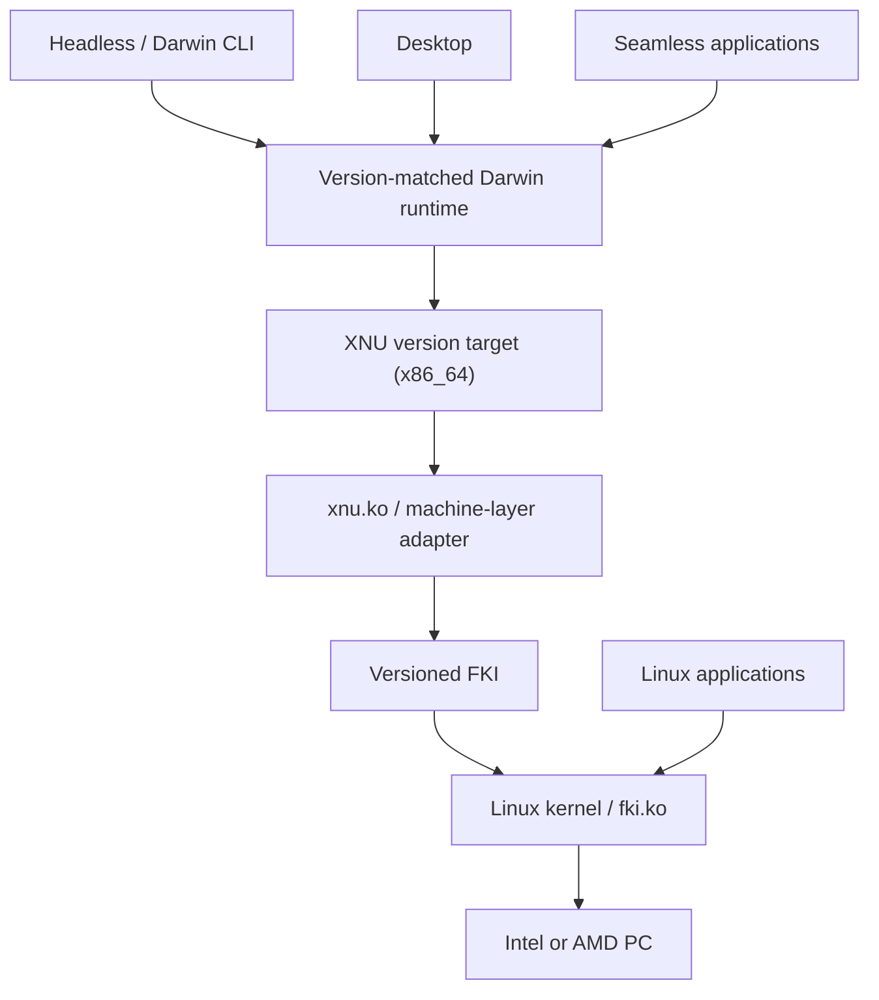

# XNULINUX x86_64

<p align="center">
  
</p>

**XNU for the PC. One platform, multiple XNU versions, Intel and AMD.**

*GNU's Not Unix. XNU's Not Unix. XNU is not Linux. Hence XNULINUX.*

**[Start here](docs/getting-started.md) · [Status](#current-status) · [Architecture](docs/architecture.md) · [Tests](tests/README.md) · [Evidence](docs/evidence/README.md) · [Documentation](docs/README.md)**

---

XNULINUX is an independent experimental open-source project building a PC-oriented XNU/Darwin compatibility platform on Linux, derived from [AFK-surf/xnulinux](https://github.com/AFK-surf/xnulinux). The goal is to run compatible Darwin and macOS software directly on standard x86_64 PCs through Linux-hosted XNU and a versioned Foreign Kernel Interface (FKI), without requiring a conventional macOS virtual machine or Hackintosh installation.

> [!IMPORTANT]
> **Research project, not an installable release.** Ordinary standalone execution of an owned Darwin PID 1 test program has been demonstrated under Intel-model emulation on both development hosts. Complete AMD boot, physical Linux-hosted XNU, Apple launchd and macOS application execution are not yet qualified.

## Start here

Coming from macOS, OpenCore or a Linux terminal? You are in the right repository. You do not need to know Mach internals to understand what we are building.

- **[macOS users](docs/getting-started.md#coming-from-macos):** What might run on Linux?
- **[Hackintosh users](docs/getting-started.md#coming-from-hackintosh):** Why a different approach to PC hardware?
- **[Linux users](docs/getting-started.md#coming-from-linux):** How does XNU fit into the existing system?
- **[Developers and testers](docs/getting-started.md#for-developers-and-testers):** Where are the code, tests and evidence?
- **[FAQ](docs/faq.md) and [hardware evidence](docs/hardware-compatibility.md):** Does it work on my machine?

No magic EFI folder, no mystery installer. If your GPU appears in a source directory, that is not yet a driver for your GPU.

> [!TIP]
> Want to try something today? Start with [Tests](tests/README.md). No root, macOS image or kernel module insertion is needed for the two public userspace tests. Downloadable packages are subject to the [distribution gates](docs/maintainers/distribution-plan.md).

[Official XNULINUX project portal](https://xnulinux.mikorist.com/)

## Current status

**CP935 | November 28, 2026 | [Project state](PROJECT-STATE.json) | [Latest research](research/2026-11/updates-916-935/README.md)**

| Research milestone | Evidence |
| --- | --- |
| Monterey standalone Intel-model PID 1 | CP627: ordinary boot without debugger on both hosts, 92.08 s and 91.35 s |
| Reproducible retained executable | CP935: 1,071 regenerated and 43 retained of 1,114 inputs; exact CP602 retained-link image |
| AMD model startup | CP622: admission remains deliberately unqualified; full boot HOLD |
| Native Ryzen Linux KVM components | CP460: strict 94/94 on each of two guest kernels; not full hosted XNU |
| Monterey version descriptor | CP629: offline identity PASS on both hosts, nine negative controls rejected on each |
| Tahoe source preparation | CP652: 13 dependency release associations verified; build HOLD |
| Research tools distribution | CP742-770: scoped source packages, shared-input object and sanitizer checks PASS; full binary/release HOLD |
| Post-kernel platform | CP661-689: graphics inventory and synthetic fixtures; full frameworks/display HOLD |
| Versioned open SDK | CP754: 249 staged headers; declarations only |
| Clean-source build and complete hosted runtime | HOLD |

**A: Historical reproduction.** 1,071/1,114 regenerated inputs; 43 retained. This is CP602 byte identity, not product completion.

**B: Functional Monterey.** CP627 remains the Intel-model standalone owned Darwin PID 1 control. Actual AMD clock return, timer delivery and ordinary admission remain HOLD.

**C: Linux-hosted Monterey.** Primary architecture objective: bounded hosted kernel execution and dependable lifecycle/recovery, then a controlled project-owned Darwin program in that hosted context. CP899/900/911/912 are scoped userspace fixtures, not native hosted XNU. No execution architecture has been selected; A need not finish before eligible B/C work.

The public ARM64 FKI v0 header is a reference, not a qualified x86 ABI. Compare hosted execution models using compatibility, failure containment, maintainability, host ownership and existing evidence before choosing one; the historical shadow-CR3 proposal is a hypothesis. A versioned semantic host-service contract and version/vendor adapters are intended, not an implemented production interface.

**Next:** prioritize eligible hosted and AMD functional prerequisites, with independent source reproduction and license review in parallel.

See the [qualification matrix](docs/qualification-matrix.md), [roadmap](docs/roadmap.md) and [research chronology](research/README.md). The current public research snapshot is distinct from the last closed regular integration review (CP497).

**Reading the results:** PASS means the stated test passed, not that the entire platform works. HOLD means qualification is incomplete. Planned means an intended feature, not a supported one.

## One platform, extensible version targets

| Target | XNU family | Current status |
| --- | --- | --- |
| Monterey 12.5 | 8020.140.41 | Active development baseline; [validated descriptor](targets/monterey/target.json) |
| Tahoe 26 | 12377 | Active preparation; implementation gated; [descriptor](targets/tahoe/target.json), [dependency comparison](research/2026-11/checkpoint-640.md); no qualified build |
| Golden Gate 27 | Source pin unverified | Research only; [x86_64 feasibility](docs/golden-gate-research.md) |

Shared platform contracts, build/test infrastructure and Linux backends are reused where compatibility is demonstrated. Source pins, generated headers, patches, binaries, Darwin runtimes and qualification remain version-specific. Intel and AMD qualification is independent for each target. See [version targets and entry gates](docs/version-targets.md).

The original ARM64 implementation remains preserved in [arm64-reference](https://github.com/mikorist/xnulinux-x86_64/tree/arm64-reference). The active tree retains potentially reusable components for review, not an inherited claim of x86_64 support. See [repository inventory](docs/README.md).

## Beyond a conventional port

XNULINUX x86_64 is developing a complete PC-oriented compatibility platform, not merely a kernel port for one CPU or a set of CPU-specific patches. The intended platform combines a vendor-aware XNU machine layer, Linux-hosted execution and version-matched Darwin runtimes supporting headless, desktop and seamless application modes. The complete platform is the engineering goal, not a claim of present functionality. The [approved post-kernel plan](docs/post-kernel-platform.md) maps retained ARM device and GPU sources, software rendering, Linux GPU backends, open runtime and the new desktop/seamless work. We reuse proven components rather than write a new hardware driver for every PC.

Independent Intel and Ryzen builds, CPU-model experiments, negative tests, cross-vendor regressions and native hardware measurements are central to this work. The reviewed historical milestones include byte-identical reproduction of the earlier 1,089-input standalone executable; the current CP602 retained-link reference has 1,114 inputs. Other milestones include early AMD machine-layer diagnostics under Milan TCG, a full Intel PID 1 regression, and native AMD KVM component replay with strict 94/94 results on each of two Linux guest kernels. SRSO qualification applies to that native KVM configuration; guest TSA and Hyper-V SRSO remain open. See [platform scope and evidence](docs/platform-scope.md).

## Project philosophy

**Adapt XNU to the PC, not the PC to the Mac.**

The long-term goal of XNULINUX is to eliminate the need for traditional Hackintosh setups by leveraging the existing Linux hardware infrastructure and bringing XNU to standard x86_64 PC hardware.

Rather than making a PC pretend to be a Mac, we aim to make XNU work with the PC as it is.

PC is the project identity and x86_64 is the target architecture. Intel is the established reference lane; development now proceeds in parallel on Intel and AMD Ryzen systems. Full AMD compatibility has not yet been demonstrated. Linux remains responsible for physical hardware and host resources; the project aims to reuse that infrastructure rather than require Mac hardware emulation. This is an independent, experimental open-source project and is not affiliated with Apple Inc.

See [project philosophy](docs/project-philosophy.md) for the design principles.

## What we want to build

For each qualified version target, one hosted XNU kernel and its shared, version-matched Darwin runtime support three intended modes:

| Mode | Goal |
| --- | --- |
| **Seamless** | Launch individual macOS applications (.app bundles) and use their windows alongside Linux applications on X11 or Wayland, without opening a full macOS desktop. |
| **Desktop** | Run a complete compatible macOS graphical environment, including its system services, Finder and Dock, in a Linux window or fullscreen. |
| **Headless** | Run Darwin command-line programs, development tools and services without a graphical environment or a mandatory proprietary macOS installation. |

Seamless application execution is a major practical goal of the x86_64 project. The complete desktop is a separate, optional mode. For each version target, all three modes are intended to share its hosted kernel and version-matched runtime rather than starting a separate kernel for every application.

The intended product runs on the same physical Intel or AMD CPU as its Linux host, without mandatory conventional VM or instruction emulation. Linux retains hardware ownership. Real GPU acceleration through qualified Linux graphics infrastructure and maximum practical measured performance are goals, not demonstrated capabilities. Desktop may be the primary fullscreen startup session; Headless and Seamless remain separate modes of the shared runtime. Prefer compact maintainable code, mature host services, measured memory and runtime cost, focused defect regressions and preserved negative evidence. Lossless distribution compression is separate from runtime optimization. No fixed performance ratio, universal device support, bug-free claim or new release gate.

## Intended architecture

**Applications → Darwin runtime → XNU → FKI → Linux → Intel/AMD PC.**

This is the intended hosted architecture, not a demonstrated end-to-end runtime.

<details>
<summary>Expand architecture diagram</summary>



</details>

<details>
<summary>Plain-text architecture diagram</summary>

```text
 Darwin CLI       macOS applications       macOS desktop
      |                   |                     |
      +-------------------+---------------------+
                          |
             Version-matched Darwin runtime
                          |
             XNU version target (x86_64)
                          |
           xnu.ko / x86_64 machine-layer adapter
                          |
                Versioned FKI interface
                          |
                  fki.ko (Linux side)
                          |
            Linux kernel on Intel or AMD CPU
```

</details>

Read [the architecture reference](docs/architecture.md) for the detailed design.

Linux remains responsible for host resources. The shared x86_64 implementation must establish its own CPU-context, memory, interrupt, scheduling and lifecycle contracts. ARM64-specific code is a reference, not a drop-in x86_64 implementation.

CPU-specific behavior is selected by detected capabilities and vendor-aware adapters where necessary. The diagram describes the intended architecture, not a completed implementation. QEMU/KVM are development and regression environments, not intended requirements of the finished product.

<a id="current-development-status"></a>

## Detailed engineering status

**Current published research snapshot: November 28, 2026, CP935. Last closed regular integration review: CP497.**

The [project state manifest](PROJECT-STATE.json) is the compact status snapshot for this publication. Twenty-one recorded 20-checkpoint windows (CP498-917) remain open for technical review, with 18 subsequent checkpoints; all 438 primary evidence hashes were verified. Historical chapters and full individual evidence clearance are tracked separately.

CP916-935: accepted regenerated inputs increased from 1,050 to 1,071 of 1,114 (96.14%); 43 remain retained. Of the 1,071 regenerated inputs, 1,067 have independent source-stage evidence. Complete retained-input links match CP602 on both hosts. All 20 checkpoints advance historical reproduction; no new boot or runtime qualification. AMD clock return and timer delivery, full clean-source build, native hosted execution, source licensing and release remain HOLD. [CP916-935 research update](research/2026-11/updates-916-935/README.md).

**Next:** Prioritize actionable existing HOLD prerequisites, including independent kernel source regeneration, genuine Monterey SDK declarations, common native build environment and AMD/hosted qualification; review the oldest open technical window. Continue Tahoe preparation and Golden Gate feasibility research without changing implementation gates. Stage A release remains HOLD. The current [roadmap](docs/roadmap.md) and [state manifest](PROJECT-STATE.json) track the exact gates.

<details>
<summary>Detailed engineering evidence and checkpoint history</summary>

The current CP602 standalone candidate has 1,114 inputs, zero undefined symbols and byte-identical Intel/Ryzen builds. Six strict Broadwell-v2 TCG UP runs pass the HFS/PID 1/Mach/BSD gate. Earlier Milan observations reached the RTC/lock-timeout boundary; CP622 captured the deliberate unqualified AMD admission rejection. Complete clock return and AMD admission remain unqualified. See [current qualification matrix](docs/qualification-matrix.md) and [CP599-612 research](research/2026-11/hosted/commpage-reproduction-599-612.md).

CP613-620: offline clock calibration agrees on both hosts; three current source units were freshly compiled on each host, and both relinks reproduced the exact 1,114-input CP602 kernel using 1,111 retained objects. The compiler patch and 290 resource headers match; both linker metadata files were regenerated. Of the current input objects, 1,069 match CP444 byte-for-byte. The remaining 45 require further provenance assessment. The historical clock candidate is unqualified and not integrated. No new guest boot was performed.

CP621: four observer-free CP602 launches reached the loader metadata-ready marker but timed out after eight seconds without a validated completion signal. This is a HOLD on ordinary boot evidence, not proof of a kernel failure. See [CP621](research/2026-11/checkpoint-621.md).

CP622 corrects the missing serial observation in CP621. Both Broadwell runs reach BSD buffer initialization; both Milan runs explicitly report that AMD admission is unqualified. No independent ordinary PID 1 completion was observed. [CP622 report](research/2026-11/checkpoint-622.md).

CP623: on both hosts the unchanged Broadwell serial output remains at 1,312 bytes from 12 through 60 seconds. The owned PID 1 fixture has no console completion output; silence cannot distinguish success from failure. [CP623 report](research/2026-11/checkpoint-623.md).

CP624: a separate owned console-reporting diagnostic builds byte-identically on both hosts and passes offline executable checks. Its diya HFS image passes read-only verification and payload extraction. No new guest run. [CP624 report](research/2026-11/checkpoint-624.md).

CP625: separate console fixture reports ordinary HFS root mount and init load attempt by 92.08 seconds, with devfs mount error 2 and no terminal marker by 100 seconds. [CP625 report](research/2026-11/checkpoint-625.md).

CP626: corrected standalone fixture reports XNUL_PID1_624_PASS at 92.08 seconds without a debugger on diya Broadwell TCG. No prior devfs error, failure marker or panic is reported. [CP626 report](research/2026-11/checkpoint-626.md).

CP627: both hosts reproduce ordinary Intel-model owned PID 1 completion with identical artifacts. Ryzen independently rebuilt the loader; the verified HFS image was transferred. [CP627 report](research/2026-11/checkpoint-627.md).

CP628: source comparison supports investigating shared infrastructure across Monterey and Tahoe. This is source similarity, not compatibility qualification. [CP628 report](research/2026-11/checkpoint-628.md).

CP629: [Monterey target descriptor](targets/monterey/target.json) passes offline identity validation on both hosts, with nine rejected negative controls each. [CP629 report](research/2026-11/checkpoint-629.md).

CP630: 19 source objects per host regenerated byte-for-byte; both complete relinks include 22 regenerated and 1,092 retained objects and match CP602. [CP630 report](research/2026-11/checkpoint-630.md).

CP631: [Tahoe draft descriptor](targets/tahoe/target.json) records the public research reference and upstream Intel build profile. Source inventory only; no build or runtime qualification. [CP631 report](research/2026-11/checkpoint-631.md).

CP632: [candidate dependency references](targets/tahoe/dependency-references.json) verified by tag; release grouping remains provisional. [CP632 report](research/2026-11/checkpoint-632.md).

CP633: fresh public structural validator tests pass on both hosts with GCC and on Ryzen with Clang. Intel Clang 19 lacks its UBSan runtime. [CP633 report](research/2026-11/checkpoint-633.md).

CP634: physical Intel Clang runtime restored, original test passes; isolated MCP dependency remains HOLD. [CP634](research/2026-11/checkpoint-634.md). CP635: public Python verifier passes on both development hosts. [CP635](research/2026-11/checkpoint-635.md).

CP636: both development environments reproduce an identical private source-only research tools archive and pass the unpacked tests. Attribution and binary distribution remain HOLD. [CP636](research/2026-11/checkpoint-636.md).

CP637: four fresh GCC builds pass; same-environment binaries match, different compiler environments produce different binaries. Stage A release remains HOLD. [CP637](research/2026-11/checkpoint-637.md).

CP638: self-contained source archive reproduced on both hosts, and both Python sources match the retained CP335 manifest. Attribution and common binary build remain HOLD. [CP638](research/2026-11/checkpoint-638.md).

CP639: 28 regenerated inputs in each exact 1,114-input relink. [CP639](research/2026-11/checkpoint-639.md). CP640: targeted Monterey/Tahoe source comparison; 21 of 25 utility units identical, but generated header and ABI compatibility remain open. [CP640](research/2026-11/checkpoint-640.md).

CP641: all 68 ARM-reference GPU and 45 kext files are retained exactly; x86 driver and runtime qualification remain open. [Post-kernel platform plan](docs/post-kernel-platform.md), [CP641](research/2026-11/checkpoint-641.md).

CP642: retained framebuffer conversion helper passes independent synthetic tests on both x86_64 hosts; no live display or GPU qualification. [CP642](research/2026-11/checkpoint-642.md).

CP643-755: CP700 reproduces the exact CP602 executable with 95 regenerated and 1,019 retained inputs. CP745-747 establish scoped dual-host compiler and Blocks compile/link regressions; CP754 reaches 249 staged SDK headers. CP755 reproduces an instrumented object from one shared preprocessed input and passes 229 native checks per host; independent preprocessing and final binaries still differ. Complete AMD boot, physical hosted XNU, clean-source build, full SDK/runtime, graphics and release remain HOLD. [CP643-755 research update](research/2026-11/updates-643-755/README.md).

CP756-775: original Monterey declaration probes expose 18 missing generated userspace headers; retained-header Stage A preprocessing and object identities match, and source-built UBSan passes 916 unchanged fixture checks plus 24 arithmetic diagnostics. Native executable identity remains HOLD. CP771-775 independently regenerate 26 more kernel inputs (121 regenerated, 993 retained); the complete 1,114-input CP602 image remains byte-identical on both hosts. No new boot, full clean-source build, runtime, licensing or release qualification. [CP756-775 research update](research/2026-11/updates-756-775/README.md).

CP776-795: independent source regeneration and two local batch runs increased accepted regenerated inputs from 121 to 599 of 1,114; 515 remain retained. Both complete retained-input links match CP602. Shared generated-header blockers were resolved for selected groups; unresolved recipes and dependencies remain HOLD. No new boot, full clean-source build, runtime, licensing or release qualification. [CP776-795 research update](research/2026-11/updates-776-795/README.md). [Dual-host batch build workflow](docs/maintainers/dual-host-batch-build.md).

**Next:** Prioritize actionable existing HOLD prerequisites, including independent kernel source regeneration, genuine Monterey SDK declarations, common native build environment and AMD/hosted qualification; review the oldest open technical window. Continue Tahoe preparation and Golden Gate feasibility research without changing implementation gates. Monterey remains the active implementation target. See [roadmap](docs/roadmap.md) and [project navigation](docs/project-navigation.md).

The development infrastructure includes a dedicated Ryzen compute host in parallel with Intel. The latest reviewed evidence includes the [parallel development report](research/2026-11/hosted/parallel-intel-ryzen.md) through checkpoint 417 and the [cross-host OSFMK and AMD KVM report](research/2026-11/hosted/osfmk-cross-host-reproduction.md) through checkpoint 437, followed by the [full-image and AMD machine-layer report](research/2026-11/hosted/amd-machine-layer.md) through checkpoint 457 and the [machine-layer follow-up](research/2026-11/hosted/amd-machine-layer-followup.md) through checkpoint 477 and the [topology and extended-state report](research/2026-11/hosted/topology-state-and-reproducibility.md) through checkpoint 497.

The following results are recorded in the local development journal and experimental evidence. They describe different test environments and are not a claim that the complete hosted kernel is already running.

### Standalone Intel XNU

- Historical baseline: 1,089 exact link inputs; current CP602 candidate: 1,114 inputs and zero undefined symbols.
- Verified Mach VM startup, kernel scheduler round trips, timer interrupts, Mach IPC initialization, IOKit and BSD startup.
- Mounted a real read-only HFS+ root filesystem and verified native file lookup and reads.
- Executed an owned, ad hoc signed Darwin Mach-O program as PID 1 at ring 3, with native BSD system calls and Mach traps.
- Reproduced standalone user-program execution with terminal-only observation and verified restricted HFS filesystem rejection paths. CP626/627 separately establish ordinary console completion without debugger on both hosts.

These milestones were established in isolated standalone QEMU tests. The PID 1 fixture is not Apple's launchd.

### Linux-hosted Intel research

| Area | Recorded progress |
| --- | --- |
| Physical Intel execution | Selected original linked XNU instructions executed in Linux userspace; separately, source-level XNU PE and VM components recompiled for bounded ring-0 execution on a physical Intel Core i5-7500T. |
| FKI and memory | Separate GPL FKI and APSL client modules; real Linux page allocation, zero/copy, alias mapping, ownership, cleanup and concurrent mapping-lifetime tests. |
| VM objects | Restricted original object initialization, resident lookup, reference and final-release paths; further owned map and inactive address-space experiments. |
| Boot metadata | Native-layout boot arguments, mapped Mach-O metadata, original PE seed consumer and source-backed initialization. |
| Clock and entropy | Negotiated Linux host services, calendar arithmetic, hosted PRNG lifecycle and concurrent consumer tests. |
| CPU and thread state | Native-layout processor and thread records, startup callbacks, processor-set and queue initialization. |
| Scheduler-facing work | Original non-realtime queue operations across 96 priorities, realtime queues across 31 priorities, priority-selected C callbacks on two Linux workers, failure cancellation/recovery and FKI elapsed-clock accounting. |
| Mach IPC | Restricted private entry-table allocation, generation, lookup, reuse and exhaustion tests. No live Mach port objects or end-to-end hosted IPC yet. |

The integrated cooperative scheduler-facing regression (checkpoint 307) passed on both selected Linux guest kernels. Checkpoints 308-317 qualified private IPC-entry lifecycle, running timer setup and expiry, realtime selection boundaries and independent 4,096-operation queue models. The checkpoint 317 integrated result records 181 identical common inputs and 49 marker groups appearing twice on each selected Linux guest kernel. This is not a native hosted boot. Checkpoints 318-337 added owned worker service lifetimes, transactional result publication, private startup callback coverage and canonical Git replay. The final private candidate passed on both selected Linux kernels with 191 verified inputs and 62 required marker patterns (58 repeated and four singleton patterns). See the [component and replay report through 337](research/2026-11/hosted/hosted-bootstrap-replay.md).

Checkpoints 338-357 added private task ownership, reference lifecycle, transactional construction, ledger templates and source-backed schema validation. Both selected Linux guests passed the 227-input candidate with 78 marker groups and 152 required marker occurrences each. See the [task and ledger report](research/2026-11/hosted/hosted-task-ledger.md).

Checkpoints 358-377 qualified private typed task/thread resources, reference and allocation rollback, source-derived IPC geometry and non-destructive metadata retirement. Both selected Linux guests passed a fresh private Git-tree replay of 255 inputs and 94 marker groups. See the [task, thread and IPC report](research/2026-11/hosted/hosted-task-thread-ipc.md).

Checkpoints 378-397 verified retained-source provenance, rebuilt 15 native reference objects from an isolated 496-input closure, and replayed both the 258-input private candidate and its 174-input runtime subset on both selected Linux guests. See the [provenance and reproduction report](research/2026-11/hosted/hosted-provenance-reproduction.md).

These are source-backed and bounded integration tests. They do **not** establish native XNU stack switching, a complete hosted world switch, native scheduler dispatch, or a booted hosted Darwin userspace.

### Cross-host reproduction and AMD component testing

Through CP497, independent 1,109-input links and matching runtime section inventories are verified on both hosts. APIC/LLC membership, Darwin generic subtype grading and guarded extended-state metadata are tested within their documented scopes. Full Intel standalone PID 1 passes on the corrected CP495 candidate (CP497); AMD remains at pre-admission. See the [CP478-497 report](research/2026-11/hosted/topology-state-and-reproducibility.md).

Through CP477, independent 1,102-input strict links and actual Milan TCG pre-admission diagnostics pass on both development hosts. Vendor-aware clock, performance, MCA, memory-type, extended-state, TLB and MONITOR metadata contracts have been tested. At that review boundary, the full Intel standalone PID 1 regression was CP475. Full AMD admission and complete hosted runtime remain open. See the [CP458-477 follow-up](research/2026-11/hosted/amd-machine-layer-followup.md).

Both hosts independently reproduced the selected 297 OSFMK C objects (290 original references, four historical compatibility references and three new strict references) and a byte-identical 4,598,216-byte relocatable Mach-O after canonicalizing input paths and timestamps. This earlier milestone was a relocatable link, not a complete kernel link. Actual Ryzen nested KVM runs now match all 94 functional marker groups on both selected guest kernels; strict qualification in that nested Hyper-V environment remains HOLD on the SRSO guest warning. See the [checkpoint 437 report](research/2026-11/hosted/osfmk-cross-host-reproduction.md).

Through checkpoint 457, all 1,089 baseline named inputs and the full strict executable match across hosts. The separate 1,092-input AMD diagnostic links have identical contents and addresses for all 35 sections, not identical complete files. Early AMD discovery executes in XNU under EPYC Milan TCG on both hosts; Intel full PID 1 regression passes on the new candidate. AMD admission and full AMD boot remain open.

**Native AMD update (CP460):** [Native AMD KVM component replay and SRSO qualification](research/2026-11/hosted/native-amd-kvm.md). Both selected guest kernels pass the original strict 94-group verifier on native Ryzen Linux. SRSO is Safe RET on host and guests. Guest TSA and CPU feature dependency remain open; full AMD XNU boot is not qualified.

</details>

## Hardware and Linux compatibility

The project targets standard x86_64 PCs, not a single CPU model. Current development proceeds on both Intel and AMD Ryzen, including investigation of older Intel generations, rather than matching a particular Mac model.

- Intel reference and regression host: Core i5-7500T (Kaby Lake), Debian Linux.
- Primary compute and AMD development host: Ryzen 7 5700X (Zen 3, 8 cores / 16 threads), Linux under WSL2.
- Older Intel target under investigation: Core i7-4770 (Haswell).
- Earlier host-service and VM regression series covered representative distribution kernels from Linux 6.0 through 6.19.
- Current focused regression targets: Linux `7.3.5-2-liquorix-amd64` and `6.19.14-2-liquorix-amd64`.

The historical kernel matrix covers specific components and configurations, not a guarantee of full XNU compatibility with every Linux release. AMD development is active in parallel with Intel; full AMD compatibility remains unqualified. A minimum supported CPU or kernel version has not yet been established. The intended implementation shares its source tree, FKI ABI, build system and Darwin runtime across Intel and AMD. Development now uses both an Intel Linux host and an AMD Ryzen 7 5700X Linux environment under WSL2. Ryzen is a primary compute and AMD development host; Intel remains a separate reference and regression host. AMD-model TCG tests, nested hardware virtualization, and bare-metal qualification remain distinct. See the [cross-vendor testing plan](docs/testing.md#planned-cross-vendor-x86_64-test-strategy).

## XNU versions

| Target | XNU source family | Status |
| --- | --- | --- |
| macOS Monterey 12.5 | `8020.140.41` | Current shared x86_64 development baseline |
| macOS Tahoe 26 | `12377` | Active preparation; implementation gated |
| macOS Golden Gate 27 | Unverified | Research only; Intel/AMD feasibility unproven |

**Project goal: one XNULINUX, multiple version targets.** Monterey is the active baseline and Tahoe is an active preparation target; the goal is to retain both rather than replace one with the other. Share the versioned FKI contract, build orchestration, regression infrastructure, Linux backends and compatible application integration. Keep source pins, generated headers, patches, binaries and version-matched Darwin runtime separate. Qualify Intel and AMD independently for each target. After stable physical Linux-hosted Monterey execution, implement and qualify Tahoe; preparatory source research can proceed earlier. Develop headless, desktop and seamless modes for both without requiring a completed Monterey desktop before Tahoe work. The upstream `12377.121.6` revision is the verified Tahoe 26.5 source reference; the build and runtime remain unqualified. Golden Gate is a separate [research-only target](docs/golden-gate-research.md), not a supported x86_64 system.

The intention is to reuse validated common FKI infrastructure through version-specific adapters, without mixing incompatible source revisions or build artifacts.

**Extensibility principle:** adding a future XNU version target should extend the existing platform, not create another project. See the [version-target entry plan](docs/version-targets.md). Tahoe preparation is recommended after CP630; implementation retains the stable physical Linux-hosted Monterey Intel gate. The logical repository layout in the entry plan is owner-approved; implementation is staged.

## Roadmap

- [x] Standalone Intel-model XNU build and owned test-program completion, including ordinary boot without debugger.
- [x] First declarative Monterey target descriptor, offline identity validation.
- [ ] Complete AMD-model standalone admission and userspace qualification.
- [ ] Clean-source regeneration and versioned build orchestration.
- [ ] Tahoe preparation, then implementation after the approved Monterey hosted gate.
- [x] Bounded physical execution of selected XNU source components and FKI services.
- [x] Initial source-backed hosted VM, startup, clock and scheduler-facing integration tests.
- [x] Establish parallel Intel and Ryzen development environments.
- [ ] Complete shared x86_64 hosted machine layer, address-space and execution-context integration, with vendor-specific qualification where required.
- [ ] Native hosted task, scheduler, Mach IPC, BSD and userspace startup.
- [ ] Open headless Darwin runtime and compatible application execution.
- [ ] Optional graphical desktop and seamless application-window integration.
- [ ] Reproducible source release, installation and hardware compatibility documentation.
- [ ] Active XNU 12377 / Tahoe preparation and gated implementation.
- [ ] Golden Gate 27 research: source availability, x86_64 kernel and userspace feasibility.
- [ ] Continue parallel AMD-model regressions and qualify native AMD execution on Linux PCs.

## Source availability and research documentation

The x86_64 work is being developed with several parallel AI-assisted research agents and a human maintainer. Successful and failed experiments are recorded with their source revisions, test conditions, evidence and limitations.

The public source tree is being reorganized separately from active local research. Reviewed x86_64 implementation files, build procedures and research documentation will be integrated incrementally into the [x86_64-port branch](https://github.com/mikorist/xnulinux-x86_64/tree/x86_64-port). There is no supported x86_64 installation command or public binary release at this stage.

The original discussion and earlier public milestone report are available in [upstream Issue #10](https://github.com/AFK-surf/xnulinux/issues/10) and the [x86_64 progress update](https://github.com/AFK-surf/xnulinux/issues/10#issuecomment-7174745326).

## Open source, licensing and attribution

The x86_64 platform implementation is intended to be fully open source, including its required build tools and dependencies. The Linux FKI and XNU sides retain separate licensing and provenance: GPL-2.0-only and APSL-2.0 respectively, with file-specific licenses preserved. See [LICENSE](LICENSE) and [LICENSES](LICENSES/). License compatibility and source redistribution remain subject to review.

Proprietary macOS system components, libraries and applications are separate from the open-source platform implementation. No proprietary Apple system images or binaries are distributed by this project. Compatibility does not grant permission to use or redistribute proprietary software; applicable licenses and hardware restrictions must be respected.

This project preserves the Git history and attribution of [AFK-surf/xnulinux](https://github.com/AFK-surf/xnulinux). The original ARM64 project remains independently maintained by its authors. Its documentation and achievements are not presented as x86_64 results.

Thanks to Heyang Zhou and the original xnulinux contributors, Apple Open Source, [macOS-DroidVM](https://github.com/Droid-VM/macOS-DroidVM), [UniXNU](https://github.com/UniXNU), and the contributors to LLVM, cctools, metal2vulkan, Mesa, virglrenderer and krunkit for their respective upstream work. Original copyright and license notices remain in the source tree and Git history.

Copyright © 2026 Heyang Zhou and contributors (original xnulinux).

macOS, Metal and XNU are trademarks of Apple Inc. This project is not affiliated with or endorsed by Apple.

## Incremental public development

Reviewed research outcomes are published chronologically, including PASS, FAIL and HOLD. Each reporting increment updates this README and the affected status documents. The 20-checkpoint technical integration review remains separate; unqualified code is not promoted merely because its results are published. The first public increment includes the [research journal](research/README.md), [qualification matrix](docs/qualification-matrix.md) and [standalone Intel Mach-O metadata validator test](tests/hosted/monterey/mach-header-validator/README.md). The next increment adds a [standalone replay evidence verifier](tests/hosted/monterey/replay-verifier/README.md) and the research update through checkpoint 337. The third increment publishes the task and ledger report through checkpoint 357. The fourth documents task/thread and IPC resource qualification through checkpoint 377. The fifth reports provenance and reference reproduction through checkpoint 397. Parallel development continues with a single integration history. Passing research tests are not automatically production-ready; unresolved source, license or build dependencies are held for review.

## Evidence and demonstrations

[Evidence index](docs/evidence/README.md) is the entry point for verified results, reports and future screenshots or recordings. No simulated desktop screenshot is presented as a running system.

## Documentation and research archive

New here? Read the [getting-started guide](docs/getting-started.md). If you are looking for installation commands, there are none yet. We do have two small [public userspace tests](docs/getting-started.md#what-you-can-run-today) that require neither a Mac image nor a kernel module.

The [engineering history through CP612](research/2026-11/history/engineering-history-through-612.md) connects the original port investigation with the shared PC-platform effort, retained evidence and development-tool incidents.

- [Project navigation and responsibilities](docs/project-navigation.md)
- [Developer documentation](docs/README.md)
- [Research journal and chronological monograph](research/README.md)
- [Architecture decisions](docs/adr/README.md)
- [Contributing](CONTRIBUTING.md) and [security reporting](SECURITY.md)
- [Changelog](CHANGELOG.md) and [AI-assisted development](AI-METHODOLOGY.md)
- [Planned downloads and distribution gates](docs/maintainers/distribution-plan.md)

The historical reports are edited accounts of recorded experiments; they are not a full public reproduction bundle or a certification of every underlying test.


> If you’re in a hurry, remember: What’s the point of replacing Hackintosh if all we’re building is another Hackintosh with a different sticker?

<p align="center">
  <sub>Support the maintainer via the existing <a href="https://diyaudio.rs/">diyAudio.rs</a> donation button. Thank you!</sub>
</p>
<p align="center">
  <a href="https://www.paypal.com/cgi-bin/webscr?cmd=_s-xclick&amp;hosted_button_id=AEXH39XRNHZQ2&amp;currency_code=EUR"></a>
</p>

---

<sub>Personal thanks from the maintainer: to Linus Torvalds, for Linux and the engineering culture that grew around it, and to RehabMan, for years of practical knowledge shared with the Hackintosh community. After two decades of working with Hackintoshes, I owe both of you a great deal. Neither is involved in or endorses this project. The original upstream contributors and their work retain full attribution above.</sub>
