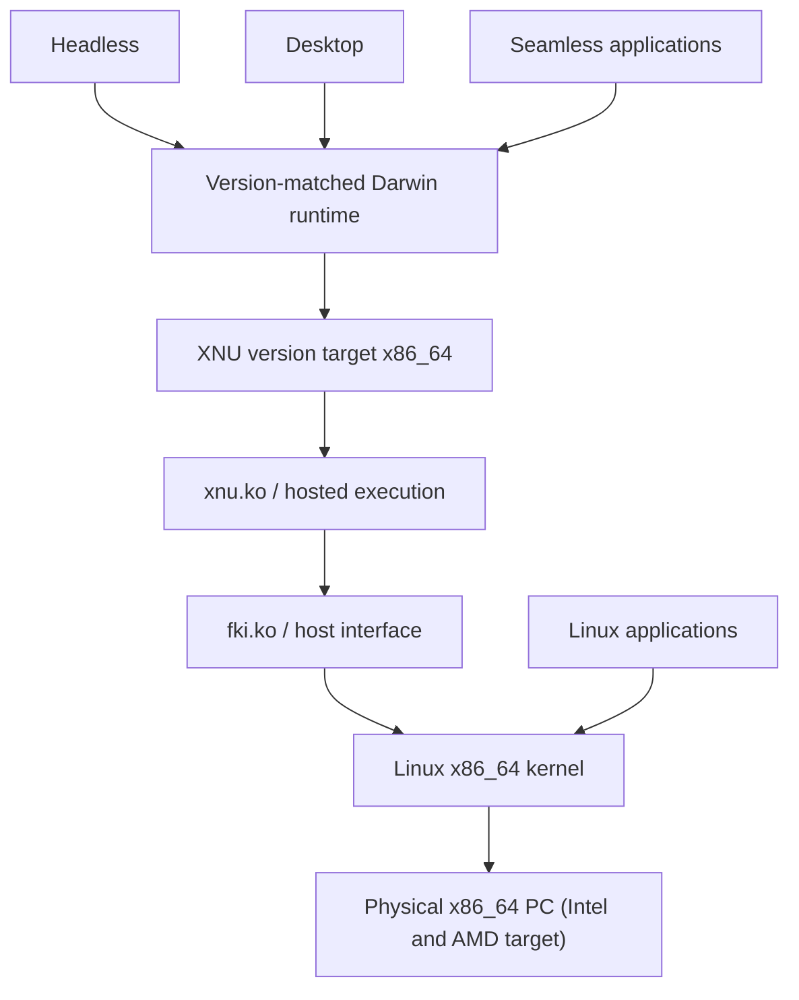

# Target architecture

The project brings XNU to standard x86_64 PCs running Linux, targeting Intel and AMD x86_64 hardware. [Adapt XNU to the PC, not the PC to the Mac](project-philosophy.md). QEMU is a development and regression environment, not a required production layer.

Expand diagram

*Proposed architecture, not a demonstrated end-to-end implementation.*

## Platform layers

The architecture is intended as a complete PC-oriented compatibility platform, beyond the initial architecture port. A vendor-aware machine layer handles actual CPU identity, cache geometry, topology, time and processor-resource contracts. A common hosted execution and FKI boundary must preserve Linux ownership; a shared Darwin runtime provides the intended application modes. Each layer has independent acceptance criteria. See [platform scope and evidence](platform-scope.md).

## Source versions

| Architecture | XNU baseline |
| --- | --- |
| x86_64 Monterey (active) | 8020.140.41 |
| x86_64 Tahoe (active development) | 12377 family; 12377.121.6 comparison reference |
| x86_64 Golden Gate (research only) | Source pin and feasibility unverified; [research plan](golden-gate-research.md) |
| ARM64 reference | Upstream 12377.121.6, preserved separately |

Independent source pins, build configurations and patch series are intentional. The shared FKI contract requires explicit version compatibility.

## Execution modes

Headless execution targets a minimal open Darwin runtime. Desktop mode targets a compatible complete graphical environment. Seamless mode additionally requires a real Linux window, compositor, input and focus integration layer, not merely hiding the macOS desktop.

## Post-kernel platform

The approved [post-kernel platform plan](post-kernel-platform.md) reuses Linux-owned device services, graphics and presentation infrastructure where independently qualified. Darwin-facing IOKit, graphics and runtime interfaces are target-specific until tested. The preserved ARM GPU and kext files are reference sources, not x86 drivers.

The first graphical path uses an owned framebuffer and a Linux viewer. CPU Metal candidates use metal2vulkan and lavapipe. The hardware path evaluates Venus, XnuDrm, the DRM bridge and virglrenderer over the host Vulkan driver, with independent device qualification. Desktop and seamless share services, but seamless needs an actual window/surface bridge to Wayland/X11. The open headless path is independent of proprietary Apple software.

## Boundaries

Linux owns host resources. CPU state, memory, exceptions, interrupts, SMP and module lifecycle require independent hosted qualification. Standalone boot evidence cannot substitute for these tests.

The APSL and GPL components retain their existing license separation. Proprietary frameworks remain separate dependencies, subject to their applicable licenses.

## CPU vendor portability

Intel is the established reference lane, not the platform boundary. AMD compatibility development is now active in parallel with Intel. Keep reusable host interfaces vendor-neutral where their semantics permit, and qualify vendor-specific machine-layer behavior separately. Earlier Milan TCG UP observations establish machine_init return and the RTC/lock-timeout observation boundary. CP622 records a separate explicit unqualified admission rejection. Complete clock return, CPU admission, SMP and hosted ownership remain open. See [current qualification matrix](qualification-matrix.md).

The design goal is a single x86_64 implementation across Intel and AMD, analogous to Linux CPU portability: common platform source, FKI ABI, build system and a version-matched runtime for each target, with capability-driven selection of vendor-specific machine-layer behavior. See [cross-vendor testing](testing.md#planned-cross-vendor-x86_64-test-strategy).

## Multi-version platform goal

One XNULINUX is intended to maintain Monterey 8020 and Tahoe 12377 targets for Intel and AMD x86_64; Monterey is the active implementation baseline and Tahoe is an active preparation target with its implementation gate unchanged. Golden Gate is research only. Share versioned FKI contracts, build orchestration, regression tests, Linux backends and compatible application integration. Keep each XNU source pin, build configuration, generated headers, patches, binaries and Darwin runtime/SDK version matched. Use version and vendor adapters only where necessary. All three product modes are intended for both qualified targets. Source similarity is not a binary ABI guarantee. The existing ARM64 reference is unchanged. See [CP628 comparison](../research/2026-11/checkpoint-628.md).

Adding a version target must extend the existing platform rather than duplicate it. Use explicit target descriptors and validated common interfaces, with per-version artifacts and regression evidence. See [version-target entry plan](version-targets.md).

The repository layout in the version-target entry plan was approved by the owner on November 27, 2026. Introduce it incrementally without invalidating existing builds or moving historical artifacts.
