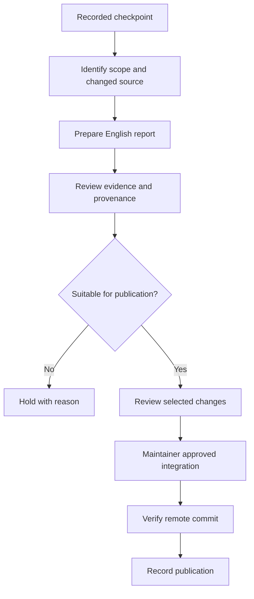

# Publishing research incrementally

The research journal is a chronological record, not the entire public repository. Keep canonical reports linked to their source checkpoints and actual evidence.

## Report content

Describe the question, source pin, configuration, commands, measured result, failed attempts, limitations and reproduction dependencies. Preserve corrections rather than silently replacing historical findings. Cross-link related reports and update the qualification matrix when the evidence changes.

## Review boundaries

A translated summary is not automatically a complete export of all associated source records. Record incomplete coverage separately. Re-review changed source records; do not publish restricted files merely to close a coverage gap.

The local inventory and publication ledger remain private working data. Only an independently verified remote commit establishes publication. A new draft, local commit or successful test is not itself a published record.

## Public communication

Group meaningful findings into reviewed reports. Update upstream discussions after relevant public evidence is available. Do not imply upstream endorsement or product support. Keep historical source versions and explicit standalone/hosted distinctions.

## Development cadence

The maintainer-approved rule after CP620 is chronological publication of every significant reviewed outcome, including PASS, FAIL, HOLD and incomplete experiments. Update the root README, qualification matrix, roadmap and affected indexes together. Ten-checkpoint work series and twenty-checkpoint technical integration reviews remain separate; an open technical review does not delay reviewed documentation. Publish only qualified reusable source and tests; hold unready code with a specific reason. Verify the current [project state manifest](../../PROJECT-STATE.json) against the checkpoint and publication evidence before publishing. Do not infer technical closure or individual-record clearance from a report.

For reader-facing changes, check the entry paths in the root README, getting-started guide, FAQ and documentation index. Keep evidence and current qualification aligned. Preserve historical reports rather than adding jokes or stylistic changes to measured results.

## Reader-facing layout

Keep a compact navigation line and short status summary above the detailed engineering history. Retain stable section headings used by publication updates, fold long historical detail without deleting it, and give diagrams a plain-text alternative. Group documentation by reader task rather than file chronology. Use accessible labels and genuine evidence links; do not add a build or release badge for an unqualified result. Keep [evidence navigation](../evidence/README.md) aligned with reviewed reports.

## Mobile-first presentation

Treat narrow phone screens as a normal reading environment. Keep the first README screen focused on purpose, navigation and current status. Use compact, wrapping text summaries for architecture; place tall or wide diagrams in collapsed details or on linked technical pages. Avoid oversized banners, wide decorative tables, large badge rows and autoplay media. Keep essential results visible without expanding anything. Use responsive images with meaningful alt text and readable captions; do not crop evidence for decoration. Preserve a plain-text alternative. Check the rendered page at desktop and phone widths when browser access is available; otherwise record that rendering was not verified. Maintain this rule for future screenshots and release documentation.
