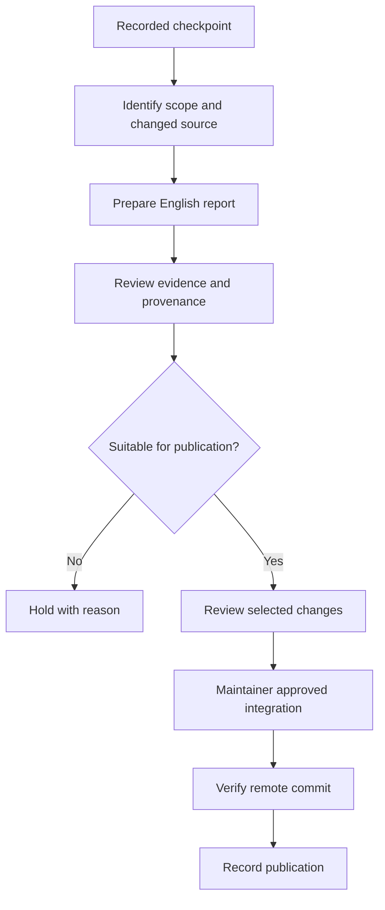

# Publishing research incrementally

The research journal is a chronological record, not the entire public repository. Keep canonical reports linked to their source checkpoints and actual evidence.

## Report content

Describe the question, source pin, configuration, commands, measured result, failed attempts, limitations and reproduction dependencies. Preserve corrections rather than silently replacing historical findings. Cross-link related reports and update the qualification matrix when the evidence changes.

## Review boundaries

A translated summary is not automatically a complete export of all associated source records. Record incomplete coverage separately. Re-review changed source records; do not publish restricted files merely to close a coverage gap.

The local inventory and publication ledger remain private working data. Only an independently verified remote commit establishes publication. A new draft, local commit or successful test is not itself a published record.

## Public communication

Group meaningful findings into reviewed reports. Update upstream discussions after relevant public evidence is available. Do not imply upstream endorsement or product support. Keep historical source versions and explicit standalone/hosted distinctions.

## Development cadence

The maintainer has approved reviewed incremental development commits after each series of 20 significant checkpoints. A passed experiment alone is not authorization to distribute all of its inputs. Publish only reusable, qualified components and reviewed reports; hold unready material with a specific reason.
