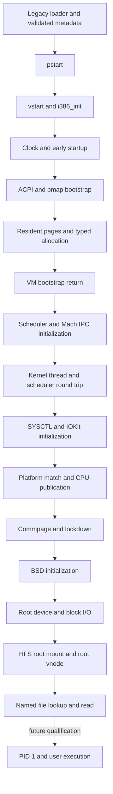

# Standalone boot sequence

This diagram summarizes observed boundaries across the experimental kernel lineage, rather than claiming a single instruction trace of every stage.

Expand diagram

## Verification boundaries

| Stage | Research checkpoint |
| --- | --- |
| Original entry through pstart | 71 |
| Metadata and i386_init entry | 73 |
| Early startup callbacks | 76 |
| ACPI count and pmap | 84–86 |
| VM and typed allocation | 94–102 |
| Mach IPC startup | 105 |
| First context and scheduler round trip | 109–111 |
| IOKit and startup table | 114–115 |
| CPU publication and lockdown | 127 |
| BSD pre-root | 143 |
| Root mount and file read | 150–154 |

The diagram is deliberately not a hosted boot sequence. QEMU, firmware adapters and diagnostic static providers are part of this research lane, not established requirements of the final product.
