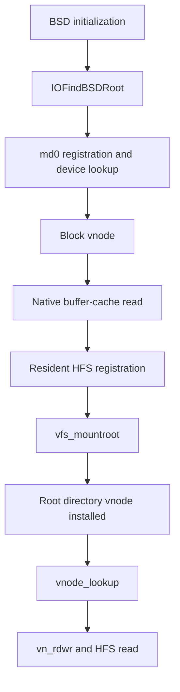

# BSD, VFS and root storage

The standalone reference reached BSD after commpage initialization and lockdown. Pthread and diagnostic crypto integration removed distinct initialization blockers before root discovery.

This is a conceptual dependency diagram of the diagnostic sequence, not a literal call stack.

The known 8 MiB nonjournaled fixture mounted read-only; the original disk contents remained unchanged. Kernel 25 read the owned 39-byte named file and returned ENOENT for a missing pathname.

The [mount report](../../research/2026-11/filesystem/first-root-mount.md) and [file-read report](../../research/2026-11/filesystem/first-file-read.md) provide evidence and hashes.

This particular file-read milestone does not imply process-1 execution. Later [standalone PID 1 research](../../research/2026-11/boot/pid1-terminal-replay.md) establishes that separate result. Writable filesystem, arbitrary-media support and hosted I/O remain unqualified.
