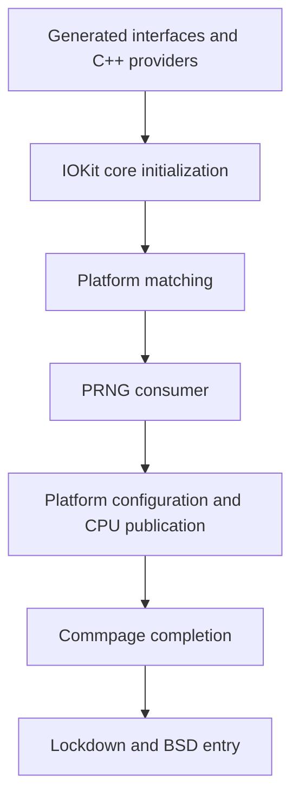

# IOKit and platform initialization

The original research encountered both compile-time compatibility problems and runtime platform dependencies. Keep those categories distinct.

The observed core initialization included OSlibkernInit, service plane and catalogue creation, root nub construction and matching startup. The restricted Legacy platform candidate addressed the missing-driver blocker, then exposed the missing initialized PRNG.

After native PRNG registration, CPU publication allowed the waiting bootstrap path to resume. Asynchronous platform completion was tracked separately from BSD entry.

The [IIG compatibility report](../../research/2026-11/iokit/iig-compatibility.md) describes generator and transport limitations. No complete live RPC, arbitrary device driver, PCI, GPU or power-management support is established by this sequence.
