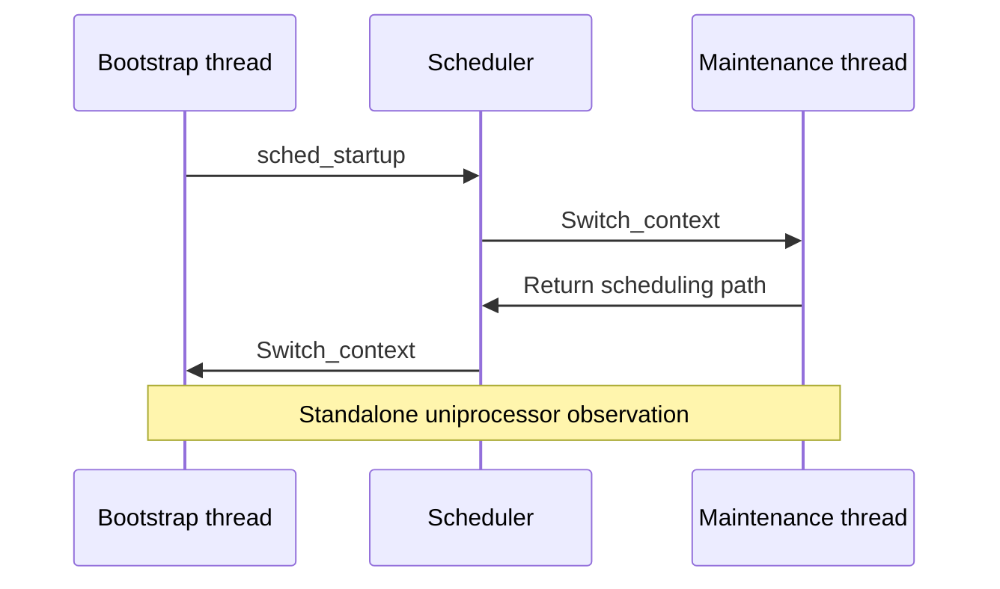

# Scheduler and CPU execution

The research observed processor and thread bootstrap, publication of the active thread, kernel task creation, first kernel context load and idle thread initialization.

Checkpoint 109 established the first real kernel stack and context switch into the bootstrap thread. Checkpoint 111 established a two-thread scheduler round trip after correcting the standalone Legacy interrupt handoff. Checkpoint 112 observed natural LAPIC timer interrupt delivery and return to the interrupted kernel context.

The separate timer test does not prove timer-driven preemption. FPU context preservation between threads, user/trap return, NMI, SMP and the Linux-to-XNU world switch require independent qualification.

See [scheduler research](../../research/2026-11/scheduler/bootstrap.md).

## Hosted continuation research (checkpoint 317)

Native-layout CPU/thread and processor-set records, all 96 non-RT and 31 RT priorities, original queue helpers, live elapsed accounting, callback cancellation/recovery and private IPC entries passed scoped Linux guest integration. Original native stack switching and full scheduler dispatch are not established by these cooperative Linux workers. See [startup and scheduler-facing research](../../research/2026-11/hosted/hosted-startup-scheduler-ipc.md).
