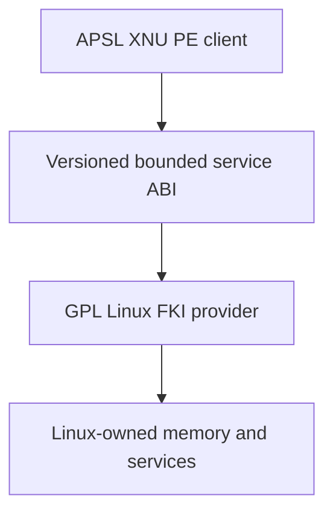

# Open-source boundaries and split FKI memory service

**Date:** 2026-11-25  
**Source checkpoints:** 199–200 and the approved MASTER project policy.

The Intel port must be completely open source, with no mandatory closed binary components in the port itself. Proprietary macOS userspace and applications are a separate licensing and distribution issue; the minimal open runtime must remain independent of them.

The GPL Linux provider and APSL XNU code retain distinct licensing and provenance. MODULE_LICENSE is Linux's compatibility classification, not a replacement for source licenses. The APSL client uses the non-GPL-compatible classification; neither false declarations nor forwarding restricted GPL-only symbols are accepted. Technical import checks do not constitute completed legal review.

## Checkpoint 199

The original APSL PE subset was independently built and executed against all twenty representative Linux 6.x kernels with unchanged source and ordinary export audits. Twenty guest boots passed, with 5,120 sessions, 10,240 service calls and 92,160 checks. No new physical insertion occurred in this checkpoint.

## Checkpoint 200

A separate GPL-2.0-only FKI provider and APSL PE client were built as distinct modules. The new shared ABI/adapter has a proposed MIT license pending attribution and license review. Original Apple notices and exact extracted-source hashes were preserved.

The private bounded memory interface uses session and handle ownership, at most two Linux pages per active session, bounded copies, explicit cleanup and stale/range/capacity rejection. It does not return raw physical pointers. Both modules' actual imports were audited against each target Module.symvers and were exclusively ordinary exports. No GPL-only forwarding, hidden lookup or policy bypass was used.

## Actual regression

Two current Liquorix and twenty representative 6.x four-vCPU guest boots passed. Each ran 256 sessions and verified allocation, access, error paths, explicit release and automatic close cleanup. Dependency pinning prevented provider unload while the client was resident; normal client/provider unload then passed.

| Metric | 22-boot total |
| --- | ---: |
| Sessions | 5632 |
| Successful bootstrap calls | 11264 |
| Integration checks | 118272 |
| Memory checks | 84480 |
| Allocations and matching frees | 16896 |

Initial packaging failed because a local pack.py was missing; correction used the known generator. This was not a runtime failure. Preexisting compiler/tool warnings and expected non-GPL taint remained documented.

Matrix SHA-256: `6bbcf15bcb4623917ce02057f09d543d6689f0da8a932c6ac2311180d4094633`.

The trusted synchronous interface is not a security boundary against malicious kernel code. Production capability negotiation, concurrency/fault injection for this new service, actual XNU VM/pmap integration, physical paired-module testing and full world switch remain open. The previous physical authorization is not automatic authorization for this module pair. No physical insertion took place at checkpoint 200.

## Subsequent qualification

Checkpoint 201 subsequently qualified the exact split pair on the physical host; see [page ownership](vm-page-ownership.md). Later concurrency, mapping and object lifetime results are separate reports.
